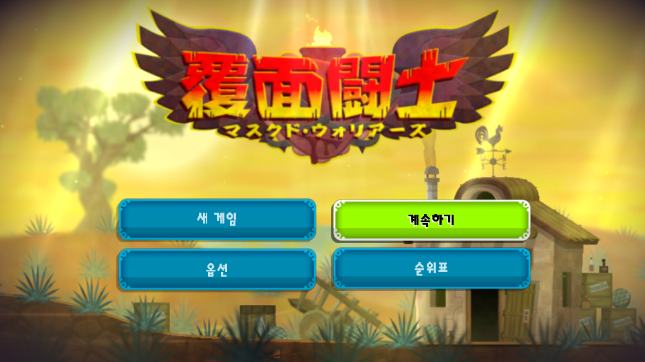
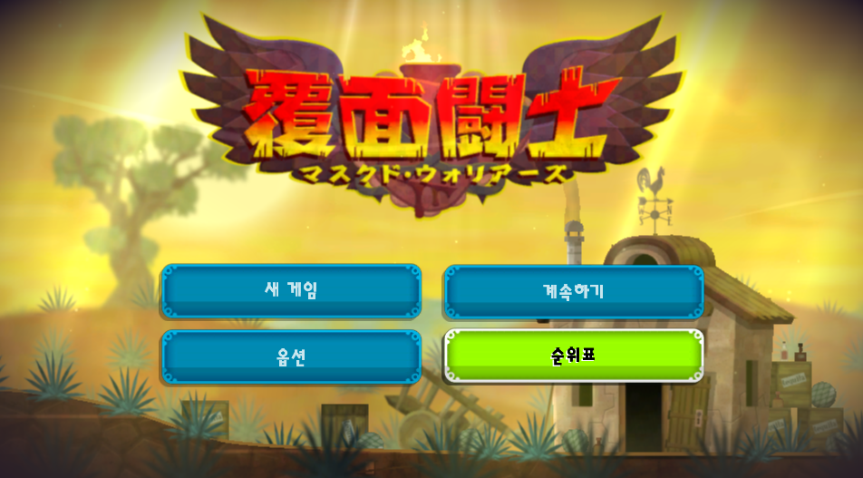

# 과카밀리! PS Vita 일본어판 한글패치 v0.9.0

PS Vita 일본어판 **PCSG00369**을 위한 비공식 한국어 패치 제작 소스입니다. 저장소에는 게임 원본 파일이나 완성된 `misc.dat`·`resources.dat`를 포함하지 않습니다. 보유한 원본 게임과 [PC판 한국어 패치](https://github.com/mushsooni/GuacameleeSTCE_kor/releases)의 파일로 직접 빌드합니다.

## 게임 소개

*Guacamelee!*는 멕시코 문화와 민담에서 영감을 받은 세계를 탐험하는 액션 플랫포머입니다. 주인공 후안은 전설적인 루차도르 가면을 쓰고 납치된 대통령의 딸을 구하러 나섭니다. 격투 기술을 이동에도 활용하고, 산 자와 죽은 자의 세계를 오가며 길을 찾아갑니다. [개발사 Drinkbox Studios의 게임 소개](https://www.drinkboxstudios.com/games/guacamelee-super-turbo-championship-edition/)

## 패치 내용

- 메뉴·대사·설명 등 일본어 언어표에 한국어 적용
- PC 한국어 패치에 없는 Vita 전용 문장 보완
- Vita에서 글자 그대로 보이던 버튼 토큰 36개 수정
- 한국어 글꼴 이식 및 타이틀 로고 이미지 교체
- 대상 게임 ID: **PCSG00369** / 버전: **v0.9.0 시험판**

PC판 *Super Turbo Championship Edition* 한국어 패치를 번역 자료로 사용하지만, 패치 대상은 **PS Vita 일본어판 게임**입니다.

## 화면

사용자가 Vita3K에서 확인한 한국어 메뉴 화면입니다. 아래 게임 화면은 **로고 교체 전 시험본**이므로 일본어 로고가 보입니다.





아래는 v0.9.0에 사용하는 **한국어 타이틀 이미지 소스**입니다. 최종 게임 화면은 아직 별도 확인이 필요합니다.


## 준비물

1. 본인이 보유한 PS Vita 일본어판 **PCSG00369**의 원본 `misc.dat`, `resources.dat`
2. [GuacameleeSTCE_kor_1.1](https://github.com/mushsooni/GuacameleeSTCE_kor/releases)의 `misc.dat`
3. Python 3.10 이상과 Pillow (`py -m pip install -r requirements.txt`)

빌드 스크립트는 Vita 원본 두 파일의 SHA-256을 확인합니다. 이미 패치된 파일이나 다른 지역판 파일은 사용할 수 없습니다. 원본 파일은 읽기만 하며, 결과는 지정한 출력 폴더에 생성됩니다.

## 빌드

저장소를 내려받은 뒤 다음 명령에서 파일 경로를 자신의 환경에 맞게 바꾸세요.

```powershell
py -m pip install -r requirements.txt
py build_patch.py `
  --vita-misc 'D:\my-game\misc.dat' `
  --vita-resources 'D:\my-game\resources.dat' `
  --pc-korean-misc 'D:\pc-korean-patch\misc.dat'
```

완료되면 `build/rePatch/PCSG00369/misc.dat`와 `build/rePatch/PCSG00369/resources.dat`가 생성됩니다. `build/work`에는 중간 결과와 검토용 보고서가 저장됩니다. 버전 확인용 예상 SHA-256은 다음과 같습니다.

| 결과물 | SHA-256 |
| --- | --- |
| `misc.dat` | `6867856dbeed2c527472a870a1ca326d613643fbbc166e7926cffce33dc16244` |
| `resources.dat` | `76419646cb2ab2d6312133d2be57238b99552eebe3485c5ceb607d541c684476` |

## 적용

PS Vita 실기기는 게임을 종료하고 기존 `ux0:rePatch/PCSG00369` 폴더를 백업한 뒤, 빌드된 `rePatch` 폴더를 `ux0:`에 복사합니다. [rePatch reDux0](https://github.com/dots-tb/rePatch-reDux0) 플러그인이 필요합니다.

Vita3K에서 시험하려면 `ux0/app/PCSG00369/`의 원본 `misc.dat`와 `resources.dat`를 먼저 백업한 다음 빌드 결과로 교체하세요. 확인과 실행은 사용자가 직접 진행합니다.

패치를 되돌리려면 rePatch 폴더를 제거하거나 백업한 원본 파일을 복원합니다.

## 확인 상태

- 사용자가 Vita3K에서 한국어 메뉴와 글꼴 표시를 확인했습니다.
- v0.9.0의 로고 교체·버튼 표기 수정본은 파일 구조와 빌드 결과를 확인했습니다. 최종 게임 화면, 전체 진행, PS Vita 실기기 적용은 추가 검증이 필요합니다.
- 이상이 있다면 화면 사진과 발생 지점, 사용한 게임 버전을 함께 알려 주세요.

## 제작 및 출처

- **YourFaceMonster** — 프로젝트 진행과 테스트
- **버섯순이** — PC판 한국어 번역
- **Snowyegret** — PC판 한국어 패치 기술 작업
- **Codex (OpenAI)** — Vita판 데이터 분석, 번역 조정, 이미지 및 빌드 스크립트 지원
- **Drinkbox Studios** — 원작 게임 개발

게임 및 번역 자료에 임의의 오픈소스 라이선스를 부여하지 않습니다.

